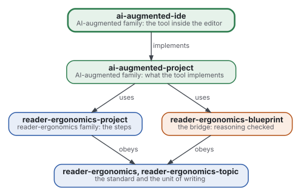
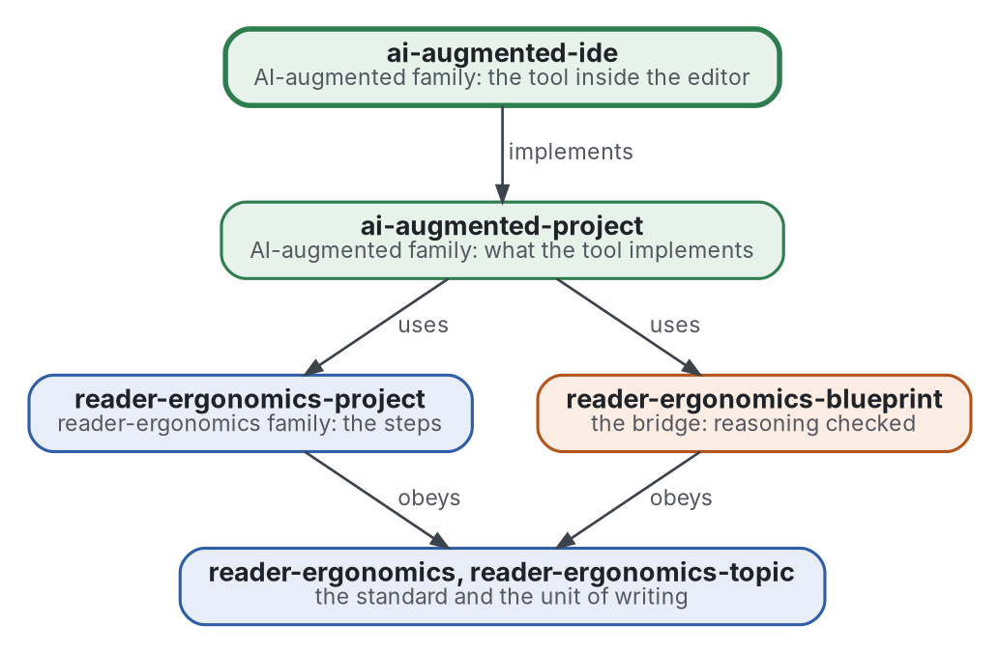

# IDE augmenté par l'IA

[](https://github.com/Tewf/ai-augmented-ide/actions/workflows/checks.yml)
[](https://tewf.github.io/ai-augmented-ide/)

Le logiciel qui met [ai-augmented-project](https://github.com/Tewf/ai-augmented-project) en œuvre dans l'éditeur, comme
**extension** de VS Code. Elle montre à la personne son projet en topics, les verdicts des vérificateurs là où ils se
tiennent, et les questions qui lui reviennent. Elle remet au modèle ce que la méthode dit de lui remettre. Libre, et
bâtie sur une extension libre là où une fait déjà une partie du travail.

Cette page en anglais : [README.md](README.md). Les deux versions suivent le même état.

> **État (2026-11-03), 0.2.0 en préparation :** la revue de l'état de l'art est écrite, la référence est nommée, la conception de l'extension est proposée, l'essai a mené ses cinq mesures. L'extension est construite dans `extension/` et empaquetée en fichier. Rien n'est publié sur une place de marché, et rien ne le sera avant que la conception d'ai-augmented-project soit approuvée. Le nom est provisoire. Ce n'est ni une norme officielle, ni une étude relue par des pairs, ni un résultat nouveau.
>
> **Comment il est fait :** avec Claude, un assistant IA d'Anthropic, sous la direction du mainteneur, comme
> reader-ergonomics. Les corrections sont bienvenues sous forme d'issues.

## L'adopter

L'extension s'installe depuis un fichier ([L'installer](#linstaller)). On peut aussi prendre la manière dont ce dépôt
est construit : un document de conception avant le code, une fiche par choix, un essai dont les mesures sont fixées
d'avance. Copiez depuis une version étiquetée ([tags](https://github.com/Tewf/ai-augmented-ide/tags)), pour qu'un
changement ultérieur ici ne change jamais votre copie.

1. Copiez la [forme du document de conception](https://github.com/Tewf/reader-ergonomics-software-design/blob/48b497ba591e9d6ffc962b1d08448930fa8158de/shapes/design-document.md)
   et remplissez-la comme le fait [design/extension.md](design/extension.md) ; gardez une fiche par choix dans
   `decisions/`, selon la [forme de la fiche de décision](https://github.com/Tewf/reader-ergonomics-software-design/blob/48b497ba591e9d6ffc962b1d08448930fa8158de/shapes/decision-record.md).
2. Si vous éprouvez une conception par un essai, écrivez ses mesures et ses seuils dans la conception d'abord, et ses
   résultats dans un fichier à part, comme le fait [spike/RESULTS.md](spike/RESULTS.md).
3. Ajoutez `checks/config.toml` avec `extends = "reader-ergonomics"`, et une table `[shape_conformance]` pour les
   formes que vous utilisez, comme celle de ce dépôt.
4. Épinglez la norme par commit et lancez les vérifications, une seule commande :

   ```sh
   git clone https://github.com/Tewf/reader-ergonomics ../reader-ergonomics
   git -C ../reader-ergonomics checkout 4f99372093729dacf982e9174e94f6b8793c513d   # version 1.20.0
   python3 ../reader-ergonomics/checks/run.py chemin/vers/votre/dépôt
   ```

Un désaccord a trois destinations :

- votre style de lecteur, comme dérogation motivée, s'il porte sur votre lecteur ;
- une extension, s'il porte sur un genre ;
- une issue sur [ce dépôt](https://github.com/Tewf/ai-augmented-ide/issues), quand ses preuves ou sa conception sont fausses.

La section de la norme, [Take your own version](https://github.com/Tewf/reader-ergonomics/blob/4f99372093729dacf982e9174e94f6b8793c513d/README.md#take-your-own-version), donne le reste.

## L'installer

L'extension n'est pas publiée. Construisez le fichier et installez-le :

```sh
cd extension
npm ci
npx vsce package          # écrit ai-augmented-0.2.0.vsix
code --install-extension ai-augmented-0.2.0.vsix
```

- Elle s'active sur un dossier qui contient `checks/config.toml` ou `START.md`.
- Les réglages (`aiAugmented.*`) nomment le fichier des verdicts, celui des questions, le fichier de départ, l'index de la mémoire et la commande de vérification.
  Les topics viennent de `[topic] files` dans `checks/config.toml`.
- **Publier** sur Open VSX et sur la place de marché est l'étape du mainteneur, avec ses jetons. Ce dépôt n'en détient aucun.
- **Taille du modèle.** La note de remise demande à l'agent de lire d'abord le fichier de départ. Dans l'essai, un modèle local de 7 milliards de paramètres l'a fait dans 2 sessions sur 5 au mieux. Un modèle de 8 milliards ne l'a jamais fait. Deux modèles en nuage l'ont fait dans 5 sur 5 chacun ([mesure 5](spike/RESULTS.md)).
  Cinq sessions par modèle, un seul jeu d'essai. Avec un petit modèle local, joignez vous-même le fichier de départ.

## Où il se place



<details>
<summary>Graphviz source</summary>



</details>

- **Il met en œuvre [ai-augmented-project](https://github.com/Tewf/ai-augmented-project)** et rien de son cru : un choix
  sur la méthode se fait là, avec une fiche, puis se met en œuvre ici.
- **Il obéit à [reader-ergonomics](https://github.com/Tewf/reader-ergonomics/blob/4f99372093729dacf982e9174e94f6b8793c513d/standard.md)** (v1.20.0) pour ses documents et exécute ses vérifications en CI ;
  le code suivra [reader-ergonomics-software-design](https://github.com/Tewf/reader-ergonomics-software-design) : un
  document de conception avant de construire, une fiche par choix.
- **Il ne pointe que vers le bas.** La carte de la famille est [ai-augmented](https://github.com/Tewf/ai-augmented).

## Périmètre

| | Quoi | Pourquoi |
|---|---|---|
| dedans | une extension de VS Code, libre | l'éditeur est là où la personne, le modèle et la machine se rencontrent déjà |
| dedans | ce qu'il montre à la personne : le projet en arbre de topics, le verdict de chaque vérificateur à côté de sa partie, les questions qui lui reviennent | la personne ne se perd pas, et ne décide que ce qui est à elle |
| dedans | ce qu'il remet au modèle : les consignes permanentes, la mémoire, le brief de l'étape, tels que la méthode les fixe | la méthode décide du contenu ; l'outil le livre |
| dedans | ce qu'il exécute : les vérifications de la machine, avant qu'un modèle ne lise la sortie | l'oracle passe en premier |
| plus tard | plusieurs agents sur un projet | [ai-augmented-agents](https://github.com/Tewf/ai-augmented-agents) d'abord, puis une mise en œuvre |
| dehors | la méthode | [ai-augmented-project](https://github.com/Tewf/ai-augmented-project) |
| dehors | un modèle, un assistant de preuve, un vérificateur à soi | d'autres les construisent ; ce dépôt les appelle |

## Le premier travail : une revue de l'état de l'art

Faite en première passe, dans [evidence](evidence/state-of-the-art/). Elle suit l'ordre d'une revue de thèse, et elle est finie quand elle peut nommer la référence :
l'extension libre sur laquelle celle-ci se bâtit, ou à côté de laquelle, avec la raison.

1. **Cadrer :** comment le domaine nomme une extension d'éditeur qui pilote un agent de code, et lesquelles sont libres.
2. **Revue :** les extensions libres d'abord, lues dans leur source et leur documentation. Ce que chacune fait déjà de
   la méthode : projet en arbre, verdicts en place, questions à la personne, mémoire, briefs, mesuré là où quelqu'un
   l'a mesuré. Les fermées sont des points de comparaison seulement.
3. **État de l'art, et le dossier contre :** ce qu'aucune extension ne fait, et ce que les praticiens rapportent qui tourne mal.
4. **Positionnement :** bâtir sur l'une, ou à côté de toutes ; le document de conception d'ai-augmented-project décide de ce qui reste à construire.
5. **Référence :** une extension libre, nommée, avec l'écart listé entre elle et la méthode.

## Questions auxquelles la revue doit répondre

- **Ce qui existe.** Quelles parties de la méthode les extensions libres mettent-elles déjà en œuvre, pour que celle-ci
  ne construise que le reste ?
- **Dessus ou à côté.** L'une d'elles est-elle une base à étendre, par sa licence et son architecture, ou un petit
  outil à côté est-il moins cher à maintenir ?
- **Les verdicts.** Comment un éditeur montre-t-il le verdict d'un vérificateur là où l'affirmation se tient, et qu'en
  fait la personne ?
- **Les questions de la personne.** Comment les décisions qui lui reviennent sont-elles montrées, avec des options,
  pour qu'aucune ne soit posée deux fois ?

## Ce que la revue a trouvé

Une première passe de 28 sources, lues le 2026-11-02 ([evidence](evidence/state-of-the-art/)).

- **Aucune extension libre ne montre le projet en arbre de sujets, ni un verdict à côté de ce qu'il vérifie.** Cline, Continue et Kilo Code dessinent chacune un seul panneau de discussion. Aucune n'emploie la vue en arbre de l'éditeur. Les diagnostics qu'elles lisent vont au modèle.
- **Les questions de la personne et la mémoire existent par morceaux.** Kilo Code a un outil de question avec options et une mémoire gardée en fichiers. Cline a un outil de question et une mémoire par convention. Continue n'a que des fichiers de règles.
- **Le problème du domaine est la supervision.** Sur 20 574 sessions d'agent, 91,49 % des résolutions visibles ont demandé une correction explicite de la personne (secondaire, d'après un résumé).
- **Le terrain bouge.** Deux des cinq extensions libres sont désormais archivées. Leurs dernières poussées datent de mai 2026.
- **Les deux parties manquantes n'ont pas besoin d'une extension d'agent.** L'éditeur offre une vue en arbre et une liste de diagnostics à toute extension.

Le domaine appelle cela un AI IDE ou un IDE coding agent. Le nom d'ici s'en approche et reste.

## La référence

**Kilo Code**, MIT, active le 2026-11-02 ([baseline](evidence/state-of-the-art/baseline.md), [décision 0002](decisions/0002-kilo-code-as-the-baseline.md)). La position est à côté de toutes : ce dépôt n'ajoute que ce qu'aucune extension n'a.

| Fonction | Kilo Code l'a | Écart |
|---|---|---|
| Arbre de sujets | non | tout |
| Verdict à côté de la chose | non | tout |
| Questions mises à part | un outil de question avec options | une liste à part de la sortie |
| Mémoire que la personne édite | des fichiers sur disque | édition non testée |
| Brief transmis tel quel | non lu | à lire |

## La conception

Proposée le 2026-11-03 ([conception](design/extension.md)). Elle change avec la conception de la méthode, qui n'est pas encore approuvée.

- Une extension mince à côté d'un agent ([0003](decisions/0003-a-thin-extension-beside-an-agent.md)) : des vues et une remise, qui ne pilote la référence que par un adaptateur facultatif.
- Trois vues lues dans des fichiers ([0004](decisions/0004-three-views-read-from-files.md)) : l'arbre de topics, chaque verdict là où il se tient, les questions de la personne.
- Un brief par renvoi ([0005](decisions/0005-a-hand-over-note-names-the-originals.md)) : le fichier de départ et l'index de la mémoire sont nommés, jamais copiés.
- Pas d'état, pas de modèle, pas de décision ([0006](decisions/0006-the-extension-keeps-no-state-and-decides-nothing.md)).
- Un essai d'un jour d'abord ([0007](decisions/0007-a-one-day-spike-before-any-build.md)) : cinq mesures, seuils fixés d'avance.

## L'essai

Fait le 2026-11-03 ([résultats](spike/RESULTS.md), [0008](decisions/0008-the-spike-passed-three-measures-and-two-are-open.md), que les résultats mettent à jour). L'extension en est tirée ([0009](decisions/0009-choices-made-while-building-the-extension.md)).

| Mesure | Seuil | Résultat |
|---|---|---|
| Arbre contre la vérification des topics | paires égales | égales sur les deux corpus |
| Verdicts contre diagnostics | égaux, sur la ligne | 14 sur 14 et 44 sur 44 |
| Délai d'affichage | moins de 2 s | 3,1 ms au pire |
| Les commandes de la référence prennent un argument | 5 sur 5, ou la personne joint | non : la personne joint la note |
| L'agent lit d'abord les originaux | 4 sur 5 | modèle local 0 sur 5 ; deux modèles en nuage 5 sur 5 chacun |

## Vérifier

```sh
git clone https://github.com/Tewf/reader-ergonomics
python3 reader-ergonomics/checks/run.py chemin/vers/ce/depot
```

La CI exécute les mêmes vérifications à chaque push, et une exécution échoue à la première erreur
([checks.yml](https://github.com/Tewf/ai-augmented-ide/blob/master/.github/workflows/checks.yml)). Chaque push sur master
construit aussi le site, [tewf.github.io/ai-augmented-ide](https://tewf.github.io/ai-augmented-ide/)
([pages.yml](https://github.com/Tewf/ai-augmented-ide/blob/master/.github/workflows/pages.yml)).

## Contenu

| Partie | Résumé |
|---|---|
| [design](design/extension.md) | l'extension proposée : ce qu'elle lit, montre et remet, et l'essai qui la teste |
| [evidence](evidence/) | la revue de l'état de l'art, 28 sources, et la bibliographie |
| [extension](extension/README.md) | l'extension : ses lecteurs, ses vues, ses commandes et ses tests, empaquetée en fichier |
| [spike](spike/RESULTS.md) | l'extension jetable de l'essai d'un jour, ses tests unitaires et ses cinq mesures |
| [decisions](decisions/) | une fiche par choix qui façonne ce dépôt, chacune ouvrant sur la décision en une phrase |

## Licence

Code sous [Apache License 2.0](LICENSE) ; prose sous [CC BY 4.0](LICENSES/CC-BY-4.0.txt). Réutilisez-le comme vous le
souhaitez, en créditant ce dépôt ; [CITATION.cff](CITATION.cff) donne une citation si besoin.
