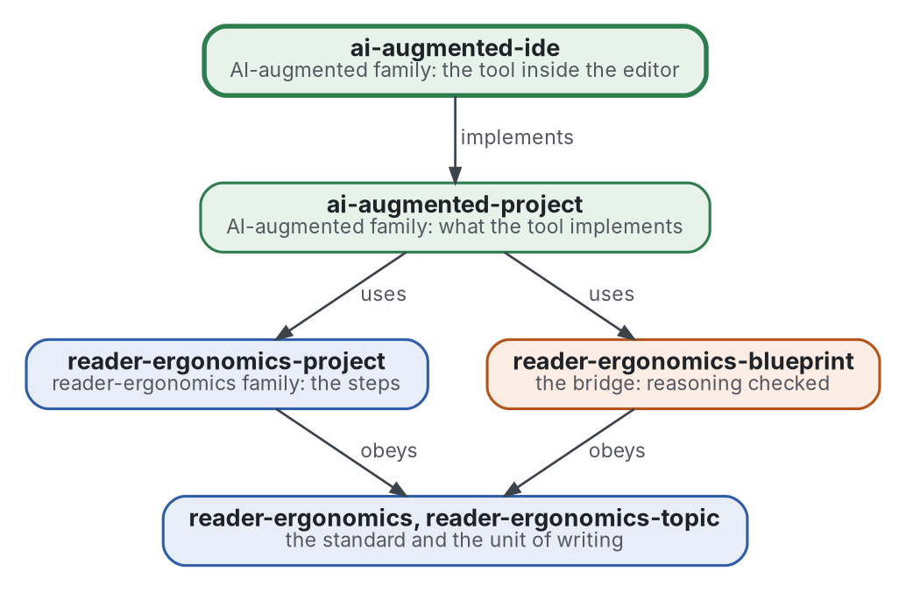

# IDE augmenté par l'IA

[](https://github.com/Tewf/ai-augmented-ide/actions/workflows/checks.yml)
[](https://tewf.github.io/ai-augmented-ide/)

Le logiciel qui met [ai-augmented-project](https://github.com/Tewf/ai-augmented-project) en œuvre dans l'éditeur, comme
**extension** de VS Code. Elle montre à la personne son projet en topics, les verdicts des vérificateurs là où ils se
tiennent, et les questions qui lui reviennent. Elle remet au modèle ce que la méthode dit de lui remettre. Libre, et
bâtie sur une extension libre là où une fait déjà une partie du travail.

Cette page en anglais : [README.md](README.md). Les deux versions suivent le même état.

> **État (2026-11-02) :** mis en place ; rien n'est encore écrit au-delà du périmètre. Le premier travail est une revue
> de l'état de l'art, non commencée, et rien n'est construit avant que la conception d'ai-augmented-project soit
> approuvée. Le nom est provisoire. Ce n'est ni une norme officielle, ni une étude relue par des pairs, ni un résultat nouveau.
>
> **Comment il est fait :** avec Claude, un assistant IA d'Anthropic, sous la direction du mainteneur, comme
> reader-ergonomics. Les corrections sont bienvenues sous forme d'issues.

## Où il se place


<details>
<summary>Graphviz source</summary>



</details>

- **Il met en œuvre [ai-augmented-project](https://github.com/Tewf/ai-augmented-project)** et rien de son cru : un choix
  sur la méthode se fait là, avec une fiche, puis se met en œuvre ici.
- **Il obéit à [reader-ergonomics](https://github.com/Tewf/reader-ergonomics/blob/b9732b9814c71768f722691f3c5049ec2b8ed378/standard.md)** (v1.19.2) pour ses documents et exécute ses vérifications en CI ;
  le code suivra [reader-ergonomics-software-design](https://github.com/Tewf/reader-ergonomics-software-design) : un
  document de conception avant de construire, une fiche par choix.
- **Il ne pointe que vers le bas.** La carte de la famille est [ai-augmented](https://github.com/Tewf/ai-augmented).

## Périmètre

| | Quoi | Pourquoi |
|---|---|---|
| dedans | une extension de VS Code, libre | l'éditeur est là où la personne, le modèle et la machine se rencontrent déjà |
| dedans | ce qu'il montre à la personne : le projet en arbre de topics, le verdict de chaque vérificateur à côté de sa partie, les questions qui lui reviennent | la personne ne se perd pas, et ne décide que ce qui est à elle |
| dedans | ce qu'il remet au modèle : les consignes permanentes, la mémoire, le brief de l'étape, tels que la méthode les fixe | la méthode décide du contenu ; l'outil le livre |
| dedans | ce qu'il exécute : les vérifications de la machine, avant qu'un modèle ne lise la sortie | l'oracle passe en premier |
| plus tard | plusieurs agents sur un projet | [ai-augmented-agents](https://github.com/Tewf/ai-augmented-agents) d'abord, puis une mise en œuvre |
| dehors | la méthode | [ai-augmented-project](https://github.com/Tewf/ai-augmented-project) |
| dehors | un modèle, un assistant de preuve, un vérificateur à soi | d'autres les construisent ; ce dépôt les appelle |

## Le premier travail : une revue de l'état de l'art

Non commencée. Elle suit l'ordre d'une revue de thèse, et elle est finie quand elle peut nommer la référence :
l'extension libre sur laquelle celle-ci se bâtit, ou à côté de laquelle, avec la raison.

1. **Cadrer :** comment le domaine nomme une extension d'éditeur qui pilote un agent de code, et lesquelles sont libres.
2. **Revue :** les extensions libres d'abord, lues dans leur source et leur documentation. Ce que chacune fait déjà de
   la méthode : projet en arbre, verdicts en place, questions à la personne, mémoire, briefs, mesuré là où quelqu'un
   l'a mesuré. Les fermées sont des points de comparaison seulement.
3. **État de l'art, et le dossier contre :** ce qu'aucune extension ne fait, et ce que les praticiens rapportent qui tourne mal.
4. **Positionnement :** bâtir sur l'une, ou à côté de toutes ; le document de conception d'ai-augmented-project décide de ce qui reste à construire.
5. **Référence :** une extension libre, nommée, avec l'écart listé entre elle et la méthode.

## Questions auxquelles la revue doit répondre

- **Ce qui existe.** Quelles parties de la méthode les extensions libres mettent-elles déjà en œuvre, pour que celle-ci
  ne construise que le reste ?
- **Dessus ou à côté.** L'une d'elles est-elle une base à étendre, par sa licence et son architecture, ou un petit
  outil à côté est-il moins cher à maintenir ?
- **Les verdicts.** Comment un éditeur montre-t-il le verdict d'un vérificateur là où l'affirmation se tient, et qu'en
  fait la personne ?
- **Les questions de la personne.** Comment les décisions qui lui reviennent sont-elles montrées, avec des options,
  pour qu'aucune ne soit posée deux fois ?

## Vérifier

```sh
git clone https://github.com/Tewf/reader-ergonomics
python3 reader-ergonomics/checks/run.py chemin/vers/ce/depot
```

La CI exécute les mêmes vérifications à chaque push, et une exécution échoue à la première erreur
([checks.yml](https://github.com/Tewf/ai-augmented-ide/blob/master/.github/workflows/checks.yml)). Chaque push sur master
construit aussi le site, [tewf.github.io/ai-augmented-ide](https://tewf.github.io/ai-augmented-ide/)
([pages.yml](https://github.com/Tewf/ai-augmented-ide/blob/master/.github/workflows/pages.yml)).

## Contenu

| Partie | Résumé |
|---|---|
| [decisions](decisions/) | une fiche par choix qui façonne ce dépôt, chacune ouvrant sur la décision en une phrase |

## Licence

Code sous [Apache License 2.0](LICENSE) ; prose sous [CC BY 4.0](LICENSES/CC-BY-4.0.txt). Réutilisez-le comme vous le
souhaitez, en créditant ce dépôt ; [CITATION.cff](CITATION.cff) donne une citation si besoin.
