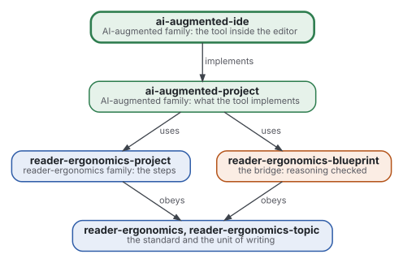
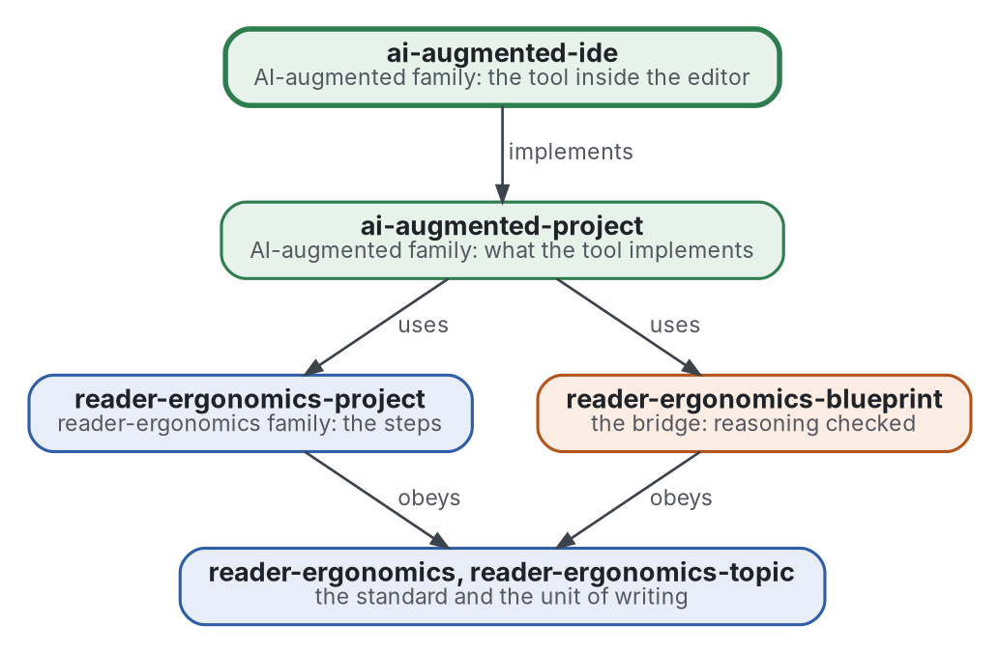

# AI-augmented IDE

[](https://github.com/Tewf/ai-augmented-ide/actions/workflows/checks.yml)
[](https://tewf.github.io/ai-augmented-ide/)

The software that implements [ai-augmented-project](https://github.com/Tewf/ai-augmented-project) inside the editor, as an
**extension** of VS Code. It shows the person their project as topics, the checkers' verdicts where they stand, and the
questions that are theirs to answer. It hands the model what the method says it is handed. Open source, and built on
an open extension where one already does part of the job.

This page in French: [README.fr.md](README.fr.md).

> **Status (2026-11-02):** set up; nothing is written yet beyond the scope. The first job is a review of the state of
> the art, not started, and nothing is built until the design of ai-augmented-project is approved. The name is
> provisional. It is not an official standard, not a peer-reviewed study and not a new result.
>
> **How it is made:** with Claude, an AI assistant by Anthropic, under the maintainer's direction, the way
> reader-ergonomics was made. Corrections are welcome as issues.

## Where it sits



<details>
<summary>Graphviz source</summary>



</details>

- **It implements [ai-augmented-project](https://github.com/Tewf/ai-augmented-project)** and nothing of its own: a
  choice about the method is made there, with a record, then implemented here.
- **It obeys [reader-ergonomics](https://github.com/Tewf/reader-ergonomics/blob/b9732b9814c71768f722691f3c5049ec2b8ed378/standard.md)** (v1.19.2) for its documents and runs its checks in CI; the code
  will follow [reader-ergonomics-software-design](https://github.com/Tewf/reader-ergonomics-software-design): a design
  document before building, a record per choice.
- **It links down only.** The family's map is [ai-augmented](https://github.com/Tewf/ai-augmented).

## Scope

| | What | Why |
|---|---|---|
| in | a VS Code extension, open source | the editor is where the person, the model and the machine already meet |
| in | what it shows the person: the project as a tree of topics, each checker's verdict beside its part, the questions that are theirs | the person does not get lost, and decides only what is theirs |
| in | what it hands the model: the standing instructions, the memory, the brief of the step, as the method sets them | the method decides the content; the tool delivers it |
| in | what it runs: the checks of the machine, before any model reads the output | the oracle comes first |
| later | several agents on one project | [ai-augmented-agents](https://github.com/Tewf/ai-augmented-agents) first, then an implementation |
| out | the method | [ai-augmented-project](https://github.com/Tewf/ai-augmented-project) |
| out | a model, a proof assistant, a checker of its own | others build them; this calls them |

## The first job: a review of the state of the art

Not started. It follows the order of a thesis review, and it is finished when it can name the baseline: the open
extension this one builds on, or beside, with the reason.

1. **Frame:** what the field calls an editor extension that drives a coding agent, and which ones are open.
2. **Review:** the open extensions first, read in their source and their documentation. What each already does of the
   method: project as a tree, verdicts in place, questions to the person, memory, briefs, measured where anyone
   measured it. The closed ones are comparators only.
3. **State of the art, and the case against:** what no extension does, and what practitioners report goes wrong.
4. **Position:** build on one, or beside all; the design document of ai-augmented-project decides what is left to build.
5. **Baseline:** one open extension, named, with the gap between it and the method listed.

## Questions the review must answer

- **What exists.** Which parts of the method do the open extensions already implement, so that this builds only the
  rest?
- **On or beside.** Is one of them a base to extend, by licence and by architecture, or is a thin tool beside them
  cheaper to keep?
- **The verdicts.** How does an editor show a checker's verdict where the claim stands, and what does the person do
  with it?
- **The person's questions.** How are the decisions that are the person's shown, with options, so that none is asked
  twice?

## Check it

```sh
git clone https://github.com/Tewf/reader-ergonomics
python3 reader-ergonomics/checks/run.py path/to/this/repository
```

CI runs the same checks on every push, and a run fails on any error
([checks.yml](https://github.com/Tewf/ai-augmented-ide/blob/master/.github/workflows/checks.yml)). Every push to master
also renders the site, [tewf.github.io/ai-augmented-ide](https://tewf.github.io/ai-augmented-ide/)
([pages.yml](https://github.com/Tewf/ai-augmented-ide/blob/master/.github/workflows/pages.yml)).

## Contents

| Part | Summary |
|---|---|
| [decisions](decisions/) | one record per choice that shapes this repository, each opening with the decision in one sentence |

## Licence

Code under the [Apache License 2.0](LICENSE); prose under [CC BY 4.0](LICENSES/CC-BY-4.0.txt). Reuse it as you wish,
with credit to this repository; [CITATION.cff](CITATION.cff) gives a citation if you need one.
