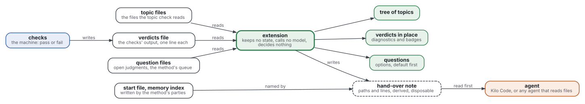

# A thin editor extension beside an existing agent

- **Decision asked.** Should ai-augmented-ide be built as a thin VS Code extension that follows the five decisions
  below, and should a one-day spike test them first? The maintainer's answer is needed once the
  [design of ai-augmented-project](https://github.com/Tewf/ai-augmented-project/blob/master/design/one-project.md) is approved,
  and before any code is written.
- **Status.** Proposed, 2026-11-03.
- **Shape:** [design document](https://github.com/Tewf/reader-ergonomics-software-design/blob/48b497ba591e9d6ffc962b1d08448930fa8158de/shapes/design-document.md)

**Summary.**

- The extension is a viewer and a courier, not an agent.
- It shows three views: the project as a tree of topics, each check's result where it stands, and the questions that are the person's.
- It hands the model two files by pointing at them, never by copying them.
- It keeps no state, calls no model and decides nothing.
- A spike of one day tests the reading and the hand-over before anything is built for good.

Terms, defined here before use:

- The **method** is [ai-augmented-project](https://github.com/Tewf/ai-augmented-project); its design is written and not yet approved.
- A **topic** is one markdown file that a reader can take alone, with a title and a summary.
- A **verdict** is one line of a check's output: its kind, its name, a place and a message.
- A **judgment entry** is a question that a check could not decide and left to the person.
- The **start file** and the **memory index** are the two files the method hands a session first.
- The **brief** is the small file this design writes to point the agent at those two files.
- The **baseline** is [Kilo Code](../evidence/state-of-the-art/baseline.md), MIT, version 7.8.25 of its extension.

## Motivation

The review found that no open extension shows a tree of topics or a verdict beside what it checked
([review](../evidence/state-of-the-art/review.md)). The method asks the extension for exactly those, and for a hand-over.

- Use case: a person opens a project of forty topics and cannot see which are checked, which fail and which wait on them.
- Use case: a check fails on line 12 of a file, and the person finds out from a chat message about it, not from the file.
- Use case: a question reaches the person inside a long model reply and is asked again two sessions later.
- Use case: the model starts a session without the commands and conventions the start file holds, because nothing
  put them in front of it.

## Goals and non-goals

- Goal: the three views, each read from files, so that deleting the extension loses nothing.
- Goal: the same files work with the baseline and with any agent that reads files.
- Goal: every line the extension shows can be traced to a file and a line of it.
- Goal: the spike can fail, and says in advance what failing means.
- Non-goal: a chat panel, a model call or a choice of model. Others build them.
- Non-goal: the five counts, the start file's size bound and the audit's list of stale files. They need programs that
  do not exist yet; the views are made to admit them later.
- Non-goal: several agents on one project, which is [ai-augmented-agents](https://github.com/Tewf/ai-augmented-agents)'.
- Non-goal: a claim that the extension helps. That is measured later, against the baseline, as the
  [baseline page](../evidence/state-of-the-art/baseline.md) sets out.

## Design

```dot
// What the extension reads, shows and hands over. Colours: files white, the extension green, the machine's
// programs blue, the agent orange, one colour per kind, named in its box.
digraph extension {
  graph [rankdir=LR, nodesep=0.35, ranksep=0.8, bgcolor="white", pad=0.2, fontname="Inter"];
  node  [shape=box, style="rounded,filled", fontname="Inter", fontsize=13, margin="0.2,0.1", penwidth=1.5, fontcolor="#1F2328"];
  edge  [fontname="Inter", fontsize=11, color="#3D434B", fontcolor="#55575F", penwidth=1.3, arrowsize=0.8];
  T [label=<<b>topic files</b><br/><font point-size="11" color="#55575F">the files the topic check reads</font>>, fillcolor="#FFFFFF", color="#3D434B"];
  V [label=<<b>verdicts file</b><br/><font point-size="11" color="#55575F">the checks' output, one line each</font>>, fillcolor="#FFFFFF", color="#3D434B"];
  Q [label=<<b>question files</b><br/><font point-size="11" color="#55575F">open judgments, the method's queue</font>>, fillcolor="#FFFFFF", color="#3D434B"];
  S [label=<<b>start file, memory index</b><br/><font point-size="11" color="#55575F">written by the method's parties</font>>, fillcolor="#FFFFFF", color="#3D434B"];
  X [label=<<b>extension</b><br/><font point-size="11" color="#55575F">keeps no state, calls no model,</font><br/><font point-size="11" color="#55575F">decides nothing</font>>, fillcolor="#E6F2EA", color="#2E7D4F", penwidth=2.6];
  W1 [label=<<b>tree of topics</b>>, fillcolor="#E6F2EA", color="#2E7D4F"];
  W2 [label=<<b>verdicts in place</b><br/><font point-size="11" color="#55575F">diagnostics and badges</font>>, fillcolor="#E6F2EA", color="#2E7D4F"];
  W3 [label=<<b>questions</b><br/><font point-size="11" color="#55575F">options, default first</font>>, fillcolor="#E6F2EA", color="#2E7D4F"];
  B [label=<<b>brief</b><br/><font point-size="11" color="#55575F">paths and lines, derived, disposable</font>>, fillcolor="#FFFFFF", color="#3D434B", style="rounded,filled,dashed"];
  A [label=<<b>agent</b><br/><font point-size="11" color="#55575F">Kilo Code, or any agent that reads files</font>>, fillcolor="#FBEDE4", color="#B4541A"];
  C [label=<<b>checks</b><br/><font point-size="11" color="#55575F">the machine: pass or fail</font>>, fillcolor="#E8EEF8", color="#2F5DA8"];
  T -> X [label=" reads"];
  V -> X [label=" reads"];
  Q -> X [label=" reads"];
  S -> B [label=" named by"];
  X -> W1; X -> W2; X -> W3;
  X -> B [label=" writes"];
  B -> A [label=" read first"];
  C -> V [label=" writes"];
  {rank=same; T; V; Q; S}
}
```

Graphviz source

Five decisions. Each has its own record, [0003](../decisions/0003-a-thin-extension-beside-an-agent.md) to
[0007](../decisions/0007-a-one-day-spike-before-any-build.md), and its own table of the options that lost.

### 1. What the extension is

It is a VS Code extension that contributes views and nothing else to the editor's chat. It runs beside an agent and
never inside one.

- It uses the editor's tree view, its diagnostics list and its file decorations. These are interfaces any extension
  may use (VS Code 2026), so no agent extension needs to change.
- The agent is replaceable. The core needs no command of the agent: it reads files and writes the brief.
- An **adapter** is an optional module that drives one agent's commands. The first is for the baseline.
- The baseline's manifest contributes these commands: New Task, Add to Context, Focus Chat Input, Reload Config and
  Skills, and Show Project Memory (Kilo 2026, read in the manifest of version 7.8.25). Whether any takes an argument
  is not tested; the spike tests it.
- Any agent that reads files named by the person or by convention works with the core alone.

| Option | Consequences | Why it lost |
|---|---|---|
| A fork of the baseline | one panel with everything | it ties the work to one project's internal changes ([0002](../decisions/0002-kilo-code-as-the-baseline.md)) |
| An agent extension of its own | full control of the hand-over | it rebuilds what three extensions hold, and it must call a model, which decision 4 forbids |
| A server speaking the editor-to-agent protocol | any editor, any agent | the review read only its repository description (ACP 2026); the baseline's support for it is not known |
| Files and a command-line program, no extension | no editor dependency | no view; the review's two missing parts are views |
| The thin extension (chosen) | a viewer that outlives any agent | it depends on an agent's commands for convenience only |

### 2. The three views

Each view reads files. None of them stores what it read.

**The tree of topics.**

- The roots are the topic files that the project's check configuration lists under its topic section.
- A topic's parent is the README of the nearest folder above it, as the topic check defines it
  ([the check](https://github.com/Tewf/reader-ergonomics-topic/blob/master/checks/local/topic.py)).
- A node shows the file's title, and its summary as the tooltip. A node that has a verdict carries its worst kind as a badge.
- Opening a node opens the file.

**The verdicts.**

- A verdict is read from a file of lines in the runner's form: `kind check path:line message`
  ([the runner](https://github.com/Tewf/reader-ergonomics/blob/b9732b9814c71768f722691f3c5049ec2b8ed378/checks/run.py)).
- An error becomes an error diagnostic and a warning becomes a warning diagnostic, at the line named, in the editor's own list.
- A verdict without a line sits on the file's first line. A verdict for a file that does not exist sits on the root topic.
- The message is shown as the runner wrote it. The extension never rewords a reason.

**The person's questions.**

- A list reads two files: the entries without an answer in the checks' answers stub, and the method's question queue.
- Each entry shows its question, its options with the recommended one first, and the file it concerns.
- Choosing an option from the method's queue appends one line to the decision log. Nothing is chosen by default.
- A judgment entry is answered in the answers file, by the person, typing in the editor. The extension opens the
  entry at its line and writes nothing, because the file's fingerprint is the runner's to compute.

| Option | Consequences | Why it lost |
|---|---|---|
| One webview dashboard | one place for all three | the three open extensions read each draw one webview; a webview cannot place a diagnostic in a file |
| Verdicts in the output panel | trivial | the person must match a line to a file by eye |
| Verdicts read from CI over the network | the whole run | a network call and an identity; the local run is the oracle |
| Questions in the chat panel | what exists | the question is lost in the output, which is the failure the review found |
| The tree from the links in each Contents table | follows the reader's path | a second reading of the rule; a topic nobody lists would be missing from the tree |

### 3. What it hands over, and how

The method hands a session the start file and the memory index, and nothing else. It does not define a brief
([dependencies](#what-this-design-depends-on)). This design defines the smallest one.

- The extension writes the brief at the start of a session, in a folder the project's ignore file excludes.
- The brief holds three things.
  The paths of the start file and the memory index, with the words "read these first, in full".
  The lines of any failed check, exactly as the verdicts file has them.
  The last lines of the decision log.
- The start file and the memory index are **never copied or reworded**. The agent reads the originals. That is what unchanged means here.
- The adapter opens a new task, and attaches the brief where the agent allows it. Where it does not, the extension
  opens the brief and the person attaches it.
- The brief is derived and disposable. The extension never reads it back, and deleting it loses nothing.

| Option | Consequences | Why it lost |
|---|---|---|
| Copy the start file into the agent's own rules folder | the agent loads it by itself | a second copy that drifts, and a path for each agent |
| Type the start file's text as the first chat message | no file to write | the text is not on disk, so the audit and the log cannot see it; the command's argument is untested |
| Serve the files through a tool the model calls | the model asks only for what it needs | the model chooses what it is shown, which the method's decision 2 rejects |
| Rely on the agent loading the start file by name | nothing to build | true only for agents that load that name; the baseline's rule files were not read |
| A pointer brief (chosen) | the originals stay the only copies | one more file, and the agent must obey "read these first" |

### 4. What it never does

- It keeps no state. Its settings are the paths of its input files, held in the workspace settings the project owns.
  What the editor remembers, such as which node is open, is the editor's.
- It calls no model. Its only outputs are the views, the decision log line, the brief and a command to the agent.
- It decides nothing. It shows a default and never applies it; it never answers a question, marks a verdict as seen
  or hides a failure.
- It may run the check command that the start file names, as an editor task, when the person asks or on save. The
  command writes the verdicts file; the extension only reads it.

| Option | Consequences | Why it lost |
|---|---|---|
| A cache of the parsed tree | faster on large projects | a second copy of the files |
| A model that sorts or summarizes the questions | shorter list | it decides what the person sees first, which is a decision |
| Apply the default after a delay | the session never waits | it decides for the person |
| A scheduler that runs the checks in the background | always fresh | cost and noise; the person asks, or the editor saves |

### 5. The spike that tests the design in a day

The spike builds a throwaway extension of about 300 lines, for one day, on two test corpora: this repository and the
method's. Nothing of it is kept unless the maintainer decides so.

| Question | Measure | Passes if |
|---|---|---|
| Does the tree agree with the topic check? | the set of parent and child pairs the extension draws, against the pairs the check derives, on both corpora | the sets are equal |
| Does every verdict arrive? | verdicts drawn as diagnostics, against lines in the verdicts file | the numbers are equal, and each sits on the named line |
| Is the display fast enough to use? | time from the file's change to the diagnostic | under two seconds on both corpora |
| Do the baseline's commands take an argument? | five trials of New Task and of Add to Context with the brief's path | the brief is attached in all five, or the answer is no and the person attaches it |
| Does the agent read the originals first? | five sessions started with the brief; whether the first reply cites a command from the start file | four of five or more |

- The thresholds are PROVISIONAL, fixed here before the spike so that they cannot be fitted to its result.
- A fail on the first three sends the design back to decisions 2 and 4. A fail on the last two sends it back to decision 3.
- The spike says whether the design can be built and handed over. It does not say whether it helps. That is the
  comparison on a task, run later in the baseline alone and with the extension.

| Option | Consequences | Why it lost |
|---|---|---|
| Build the extension, then test | one step | a wrong reading of the topic rule costs a build |
| A paper review of the baseline's source only | no code | the argument of its commands cannot be read, only tried |
| A spike of a week | more of the design is tested | a day answers the questions that can stop the design; the rest waits for the method |

## What this design depends on

The method's design is not approved. Each row names what this document borrows and what changes if it moves.

| Borrowed from the method | Used in | If it changes |
|---|---|---|
| The extension keeps no state and reads files (decision 5, [0007](https://github.com/Tewf/ai-augmented-project/blob/master/decisions/0007-the-extension-reads-files-and-hands-over-two.md)) | decisions 1 and 4 | the design is rewritten |
| The start file and the memory index are handed over, nothing else ([0004](https://github.com/Tewf/ai-augmented-project/blob/master/decisions/0004-a-short-start-file-and-an-index.md)) | decision 3 | the brief names other files |
| The model decides nothing unchecked ([0003](https://github.com/Tewf/ai-augmented-project/blob/master/decisions/0003-the-model-decides-nothing-unchecked.md)) | decisions 2 and 4 | the defaults and the answers change |
| The question queue, the decision log and the verdicts have a writer and a reader, but no format | decisions 2 and 3 | the readers are rewritten |
| A brief, which the method does not define | decision 3 | this document's brief is dropped or moved there |
| Topic files, the answers files and the audit's report are not among the six kinds of file | decision 2 | the method's table gains them |

## Consequences

- Drawbacks: the verdicts file does not exist today. The runner prints its findings and writes only the judgment
  files. Until it writes a verdicts file, the project's check command redirects its output, which is one more line to keep.
- Drawbacks: the tree re-reads the topic rule, so a change in the check must reach the extension. The spike's first
  measure is the test that finds a drift.
- Risks: the baseline can be archived, as two other extensions were in 2026. The adapter is the only part that
  breaks, and the core keeps working.
- Risks: a person who does not attach the brief gets a session without the start file. The core shows the brief's
  state, and the method's staleness audit does not cover it.
- Compatibility: nothing in the project changes. The extension adds one ignored folder and one settings block.
- Security: the brief, the verdicts and the answers are text a model reads, so text that came from outside is data and is
  never an instruction. The extension sends nothing over a network.

## Feasibility and plan

- Shown to work by: precedent for each part. The tree view and the diagnostics list are interfaces of the editor
  (VS Code 2026). The baseline contributes the commands listed above. The runner's line form is the one in its source.
  The combination has not been built.
- Tested by: the spike above; later, a test per reader that feeds it a planted file and expects the view.
- Rolled out by: the maintainer approves the method; the spike runs for a day; the maintainer reads its table; only
  then is a build planned, in a document of its own.

## Open questions

- What does the runner write, and where? The extension needs a file of verdicts. Asking the runner to write it is a
  change to [reader-ergonomics](https://github.com/Tewf/reader-ergonomics), not made here.
- What name does the start file have, and where does the project keep it? The method does not say.
- Can the tree be read from the check instead of re-deriving the parent rule? A topic list from the check would
  remove the second reading.
- Does a fact the person writes into the decision log need a key that the extension proposes? The method's question key is the model's.
